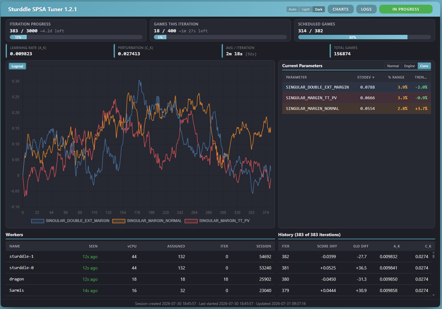
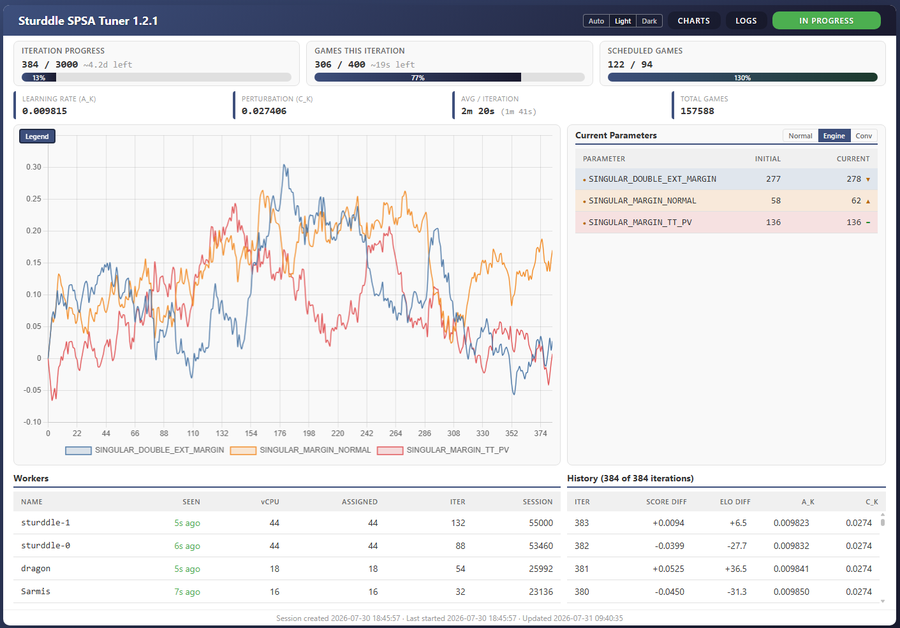
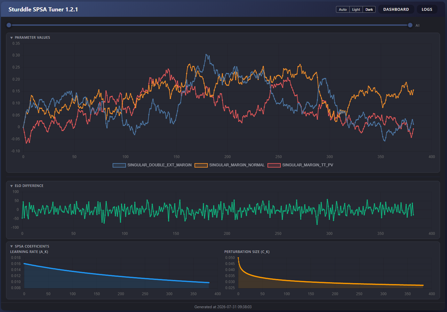
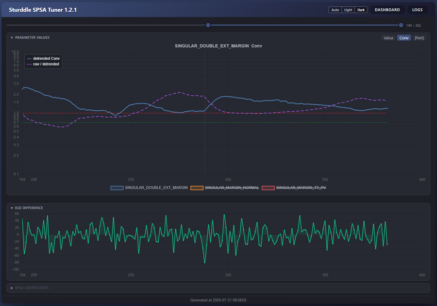

# Distributed SPSA Tuner

SPSA (Simultaneous Perturbation Stochastic Approximation) tuner for Sturddle,
distributed over a small LAN of Linux and Windows machines. Games are played with
cutechess-cli or fastchess.

- **Coordinator**: HTTP server that owns the SPSA state, hands out chunks of games
  and sizes them by each worker's measured speed.
- **Workers**: play the games locally and report scores. PGNs and logs stay on the worker.

## Prerequisites

- [cutechess-cli](https://github.com/cutechess/cutechess) or [fastchess](https://github.com/Disservin/fastchess) on each worker (fastchess handles high concurrency better)
- An engine build prepped for tuning (see [Tuning the Engine](../../../README.md#tuning-the-engine) in the main README)

On Windows, running `main.py` directly can overflow the stack at higher depths,
because `python.exe` has a small default stack. Use a built executable instead.

## Quick Start (single machine)

### 1. Generate a tuning project

From the repo root:

```bash
python tools/tuneup/spsa/genconfig.py my-test -D 8 -i 50 -g 100
```

This creates `tuneup/my-test/` with `tuning.json` (session config) and
`worker.json` (local worker config).

Options:
- First argument is the project name
- `all` (default): tune all parameters, or list specific names
- `-w`: generate worker.json only (no engine needed)
- `-s`: generate tuning.json only
- `-e VERSION_OR_PATH`: engine from dist/ (e.g. `-e 2.5.1-pieces`) or a path; default is the dist/native build
- `--ref VERSION_OR_PATH`: reference engine for reference mode
- `-D`: fixed search depth (overrides `-t`)
- `-t`: time control (default: `1+0.1`)
- `-H`: hash size in MB (default: 256)
- `-T`: engine threads (default: 1)
- `-i`: SPSA iterations (default: 10000)
- `-g`: games per iteration (default: 200)
- `-c`: perturbation as a fraction of range (default: derived from the param ranges)
- `-a`: learning rate (default: scaled from c)

The game runner is looked up as fastchess in PATH, then `*fastchess*` directories
next to the repo, then cutechess-cli in PATH.

### 2. Review and edit configs

In `tuning.json`, drop parameters you don't want tuned and adjust bounds or SPSA
settings. In `worker.json`, check the `engine`, `opening_book`, `cutechess_cli` and
`concurrency` values (concurrency defaults to the physical core count), and put
machine-specific engine options such as `SyzygyPath` in `parameter_overrides`.

### 3. Start the coordinator

```bash
cd tuneup/my-test
python ../../tools/tuneup/spsa/coordinator.py -c tuning.json
```

### 4. Start a worker (separate terminal)

```bash
cd tuneup/my-test
python ../../tools/tuneup/spsa/worker.py -c worker.json
```

## Multi-Machine Setup

### Coordinator machine

```bash
cd tuneup/my-test
python ../../tools/tuneup/spsa/coordinator.py -c tuning.json -p 8080
```

The coordinator listens on `0.0.0.0`, so any machine on the network can connect.

### Each worker machine

1. Create a `worker.json` with local paths (`genconfig.py <project> -w` writes one):

```json
{
  "coordinator": "http://192.168.1.10:8080",
  "engine": "/home/user/engines/sturddle/main.py",
  "cutechess_cli": "/usr/local/bin/cutechess-cli",
  "concurrency": 8,
  "opening_book": "/home/user/books/UHO_2024_6mvs_+085_+094.pgn",
  "book_depth": 8,
  "games_dir": "/home/user/spsa/my-test/games",
  "log_file": "/home/user/spsa/my-test/logs/worker.log",
  "parameter_overrides": {
    "SyzygyPath": "/home/user/syzygy/3-4-5/"
  }
}
```

2. Start the worker:

```bash
python /path/to/tools/tuneup/spsa/worker.py -c worker.json
```

Workers can join and leave at any time.

## Dashboard

`http://<coordinator>:8080/` shows progress, current parameter values, worker
status, recent iterations and convergence charts, updated live over Server-Sent
Events. `/charts` has the full history and `/logs` the coordinator log.

<table><tr>
<td></td>
<td></td>
</tr><tr>
<td></td>
<td></td>
</tr></table>


## Configuration Reference

### tuning.json (session-level, shared)

| Field | Description | Default |
|---|---|---|
| `engine.protocol` | Engine protocol | `"uci"` |
| `engine.fixed_options` | Fixed UCI options (Hash, Threads, etc.) | `{}` |
| `time_control` | Time control string | `"1+0.1"` |
| `depth` | Fixed search depth (overrides time_control if set) | `null` |
| `games_per_iteration` | Games per SPSA iteration | `200` |
| `output_dir` | Coordinator output (logs, checkpoint) | `"./spsa_output"` |
| `retry_after` | Worker retry interval in seconds | `5` |
| `dashboard_refresh` | SSE heartbeat in seconds | `60` |
| `dashboard_history` | History entries sent to the dashboard (0 = unlimited); also the convergence window | `100` |
| `overdue_factor` | Factor on expected duration to declare a chunk overdue | `1.35` |
| `worker_idle_timeout` | Seconds before an idle worker (no chunks) is considered dead | `60.0` |
| `chunk_timeout_factor` | Factor on expected duration for chunk timeout | `2.0` |
| `min_chunk_timeout` | Minimum chunk timeout in seconds | `60.0` |
| `min_chunk_expected_duration` | Floor for expected chunk duration; also the time constant of the worker speed EWMA | `60.0` |
| `overflow_factor` | Max games dispatched per iteration, relative to `games_per_iteration`, when idle workers race stragglers at the end of an iteration (`1.0` = off) | `1.15` |
| `ewma_warmup_chunks` | Chunks a new worker completes before it gets speed-proportional work | `3` |
| `static_dir` | Directory for static assets (favicon, etc.); empty = disabled | `""` |
| `validate_interval` | Seconds between chunk-validity checks (0 = disabled) | `5` |
| `max_retries` | Max worker crash-reconnects within `max_retries * retry_after` seconds (0 = unlimited) | `3` |
| `auto_resign` | Enable resign and draw adjudication to shorten decided games | `true` |
| `resign_movecount` | Consecutive moves below threshold before adjudicating a loss | `3` |
| `resign_score` | Score threshold in centipawns for resign adjudication | `700` |
| `draw_movenumber` | Move number after which draw adjudication is allowed | `40` |
| `draw_movecount` | Consecutive moves within threshold before adjudicating a draw | `8` |
| `draw_score` | Score threshold in centipawns for draw adjudication | `10` |
| `log_rotation` | Daily log rotation, 30 days kept | `true` |
| `spsa.budget` | Total games budget (iterations * games_per_iteration) | `10000` |
| `spsa.a` | Learning rate | `0.5` |
| `spsa.c` | Perturbation as fraction of parameter range | `0.05` |
| `spsa.A_ratio` | Stabilization constant (fraction of max iterations) | `0.1` |
| `spsa.alpha` | Learning rate decay exponent | `0.602` |
| `spsa.gamma` | Perturbation decay exponent | `0.101` |
| `spsa.draw_weight` | Score of a draw (lower weighs decisive games more) | `0.5` |
| `parameters.<name>.init` | Initial value | -- |
| `parameters.<name>.lower` | Lower bound | -- |
| `parameters.<name>.upper` | Upper bound | -- |
| `parameters.<name>.type` | `"int"` or `"float"` | `"int"` |

### worker.json (per-machine)

| Field | Description | Default |
|---|---|---|
| `coordinator` | Coordinator URL | `"http://localhost:8080"` |
| `engine` | Absolute path to engine (or wrapper script) | auto-detected |
| `cutechess_cli` | Path to cutechess-cli or [fastchess](https://github.com/Disservin/fastchess); auto-detected by genconfig (fastchess preferred) | auto-detected |
| `concurrency` | Concurrent games | physical cores |
| `opening_book` | Absolute path to opening book | auto-detected |
| `book_format` | Book format (`pgn` or `epd`); auto-detected from file extension if omitted | `""` |
| `book_depth` | Opening book depth in plies | `8` |
| `games_dir` | Absolute path for PGN output | auto-detected |
| `log_file` | Absolute path to worker log | auto-detected |
| `max_chunk_size` | Hard cap on games per chunk (0 = unlimited) | `0` |
| `max_rounds_per_chunk` | Cap = concurrency × this × 2 (0 = unlimited) | `10` |
| `http_retry_timeout` | Seconds to retry on coordinator connection errors | `300` |
| `parameter_overrides` | Per-machine UCI engine options (e.g., SyzygyPath) | `{}` |
| `cutechess_overrides` | Per-machine cutechess-cli overrides (`tc`, `depth`) | `{}` |
| `log_rotation` | Daily log rotation, 30 days kept | `true` |
| `name` | Worker identity reported to coordinator; defaults to hostname if empty | `""` |
| `reference_engine` | Path to a fixed reference engine for reference mode (see below); empty = standard mode | `""` |
| `ramdisk` | RAM disk for PyInstaller temp extraction (see below); genconfig turns it on for `--onefile` engines | `false` |
| `ramdisk_drive` | Override drive letter for RAM disk (e.g. `"R:"`); empty = auto-select | `""` |
| `auto_install_imdisk` | Auto-download and install ImDisk on Windows if not found; set `false` to manage manually | `true` |
| `ramdisk_size` | Override RAM disk size in MB (0 = auto-estimate from engine sizes and concurrency) | `0` |
| `ramdisk_decompression` | PyInstaller decompression multiplier for size estimation | `2.6` |
| `max_forfeit_pct` | Max fraction of games that can be time forfeits before discarding the chunk (0 = disabled) | `0.05` |
| `max_retries` | Max consecutive retryable errors before the worker gives up (0 = unlimited) | `3` |

### RAM Disk

PyInstaller `--onefile` engines unpack themselves into a temp directory on every
start, which at high concurrency hammers the disk. With `ramdisk` on, the worker
points the engines' temp directory at a RAM disk.

**Windows**: an [ImDisk](https://sourceforge.net/projects/imdisk-toolkit/) NTFS disk,
sized from the engine binaries and concurrency. ImDisk is downloaded and installed on
first use; installing and formatting each need a UAC prompt. The disk is removed on
clean shutdown; after a crash, a marker file lets the next run reuse it.

**Linux**: a directory under `/dev/shm`.

Not used when the engines are `.py` scripts. `ramdisk.py` can also create, clean and
remove the disk by hand.

### Reference Mode

By default theta+ plays theta- head-to-head. In reference mode each of them plays a
fixed reference engine instead. Set `reference_engine` in `worker.json`:

```json
{
  "reference_engine": "/path/to/reference-engine"
}
```

The reference engine gets only `fixed_options` and `parameter_overrides`. Each chunk
is split evenly between the two pairings, and the gradient comes from the difference
of the two scores.

### NUMA (Linux only)

On multi-node machines, run one worker per NUMA node so each keeps its memory local.
Needs `libnuma.so.1` and `numactl`.

```bash
python /path/to/tools/tuneup/spsa/split_numa_config.py worker.json    # worker-0.json, worker-1.json, ...
python /path/to/tools/tuneup/spsa/launch_numa_workers.py worker.json
```

Concurrency must be a multiple of the node count. `genconfig.py` prints these
commands when it detects NUMA.

